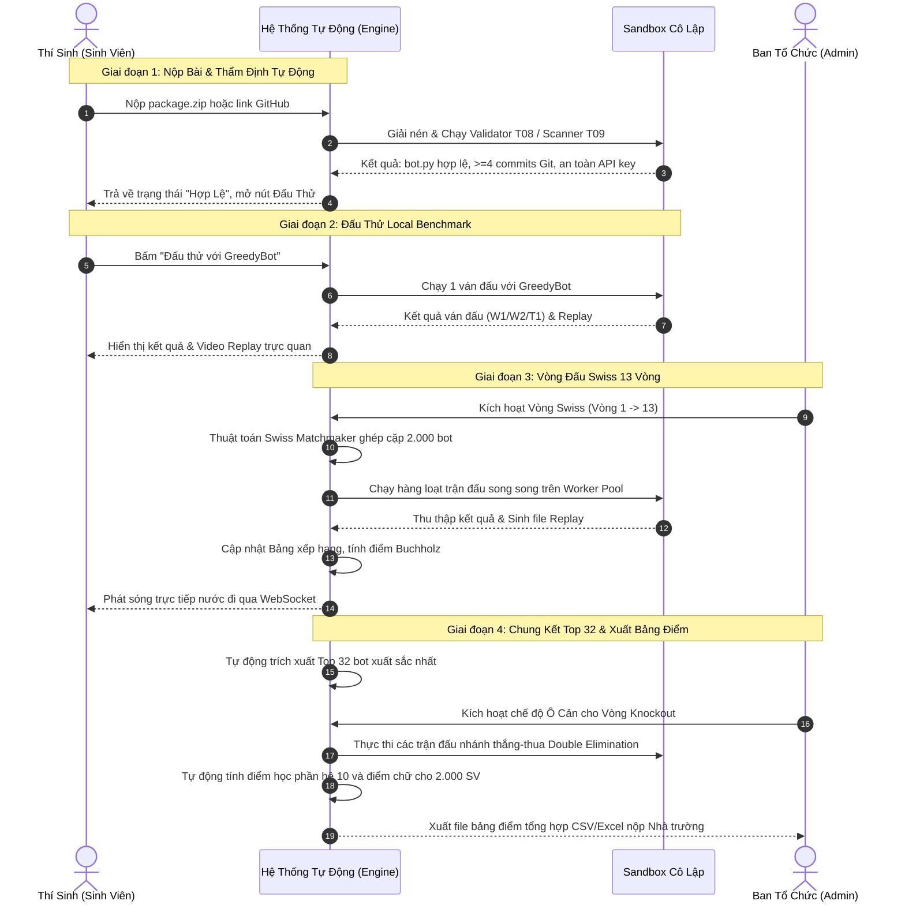

# ĐẶC TẢ USE CASE HỆ THỐNG ĐẤU TRƯỜNG BOT TRÍ TUỆ NHÂN TẠO OTTV2
## OTTv2 Autonomous Tournament Platform (Quy mô 2.000 Sinh viên)

> **Mô hình kiến trúc:** Đấu trường thi đấu và thẩm định tự động hóa 100% (Zero-Human-In-The-Loop AI Arena).  
> **Áp dụng:** Môn học Lập trình mạng — Trường Đại học Công nghệ (VNU-UET).

---

## 📌 1. Bối Cảnh & Quyết Định Thiết Kế (Decision Log)

| Hạng mục | Quyết định thiết kế | Cơ sở lý luận |
| :--- | :--- | :--- |
| **Vai trò Giảng viên** | **Bỏ qua vai trò thủ công của Giảng viên** | Chuyển đổi hệ thống thành nền tảng tự động hóa 100% như Codeforces / Kaggle để xử lý bài toán quy mô lớn (~2.000 sinh viên) mà không gây tắc nghẽn nhân lực. |
| **Tiêu chí đánh giá** | **Code tự viết + Git Commits + Ý tưởng thuật toán** | Bỏ yêu cầu lưu nhật ký prompt và lịch sử chat AI để khuyến khích sinh viên học code thực chất; xác thực tiến trình code qua lịch sử Git ($\ge 4$ commits). |
| **Cơ cấu Actor** | **3 Nhóm Actor chính** | 1. **Thí sinh (Sinh viên)**<br>2. **Ban Tổ Chức (Admin điều hành)**<br>3. **Hệ thống Tự động (Autonomous Engine)** |
| **Phương thức xếp hạng** | **Hệ thống Swiss 13 Vòng + Top 32 Double Elimination** | Đảm bảo tính công bằng cao nhất cho 2.000 bot, phân định thứ hạng bằng hệ số phụ Buchholz và Sonneborn-Berger. |

---

## 👥 2. Ma Trận Tác Nhân (Actor Matrix)

```mermaid
graph TD
    subgraph Actors [Các Tác Nhân Chính]
        ST["🧑‍💻 Thí Sinh (Sinh Viên)"]
        AD["🛠️ Ban Tổ Chức (Admin)"]
        SY["🤖 Hệ Thống Tự Động (Autonomous Engine)"]
    end

    subgraph CorePlatform [Nền Tảng OTTv2 Tournament]
        ST -->|Nộp bài, Đấu thử, Xem Replay| CorePlatform
        AD -->|Khởi chạy giải, Phát sóng, Giám sát| CorePlatform
        SY -->|Thẩm định, Xếp cặp, Trọng tài, Tính điểm| CorePlatform
    end
```

---

## 📋 3. Chi Tiết Danh Mục Ca Sử Dụng (Use Cases Catalog)

### 🧑‍💻 NHÓM 1: THÍ SINH (SINH VIÊN) — `UC-ST`

#### `UC-ST01`: Xem Luật Chơi & Tải Starter Kit
* **Mục tiêu:** Thí sinh nghiên cứu đặc tả bàn cờ 9×9, luật Búa-Kéo-Bao, ô đích $W2$ ($i9/a1$), tải bộ khởi động (`StarterKitModal`) chứa bot mẫu (`RandomBot`, `GreedyBot`) và cấu trúc nộp bài chuẩn.
* **Tiền điều kiện:** Thí sinh truy cập trang chủ hoặc trang Luật chơi.
* **Luồng chính:**
  1. Thí sinh mở trang `/rules` hoặc bấm nút "Mở Bộ Khởi Động" trên thanh điều hướng.
  2. Hệ thống hiển thị bàn cờ 9×9 trực quan, giải thích luật di chuyển 8 hướng và sức mạnh quân cờ.
  3. Thí sinh tải file mã nguồn mẫu `starter_bot.py`.

#### `UC-ST02`: Nộp Bài Làm (Upload ZIP hoặc Đăng Ký Link GitHub Repo)
* **Mục tiêu:** Thí sinh gửi gói bài nộp trước hạn chót (Deadline Cutoff).
* **Tiền điều kiện:** Thí sinh đã đăng nhập tài khoản.
* **Luồng chính:**
  1. Thí sinh kéo thả file `.zip` (hoặc dán link GitHub Repo) vào khung nộp bài tại `/submit`.
  2. Bấm "Xác Nhận Nộp Bài". Hệ thống lưu gói nộp vào kho lưu trữ nội bộ và chuyển trạng thái sang `validating`.
* **Ngoại lệ:**
  * File không đúng định dạng `.zip` $\rightarrow$ Báo lỗi từ chối ngay lập tức.
  * Đã qua thời hạn nộp bài $\rightarrow$ Khóa nộp bài, giữ bản nộp hợp lệ trước hạn.

#### `UC-ST03`: Đấu Thử Trực Tiếp Với Bot Mẫu Trong Sandbox (Local Benchmark)
* **Mục tiêu:** Xác nhận bot phản hồi đúng luật, không ném exception và không vượt quá $200\text{ms}$.
* **Tiền điều kiện:** Bài nộp đã vượt qua thẩm định cấu trúc (`status == 'valid'`).
* **Luồng chính:**
  1. Thí sinh bấm "Đấu Thử Với GreedyBot".
  2. Hệ thống nạp bot vào Sandbox cô lập và điều phối trận đấu thử nghiệm 1 ván.
  3. Trả về kết quả: Thắng/Thua/Hòa, mã kết thúc ($W1, W2, T1$), tổng số nước và đường link xem Replay chi tiết.

#### `UC-ST04`: Tra Cứu Trạng Thái & Khóa Cam Kết Mã (Commit Lock Lookup)
* **Mục tiêu:** Thí sinh kiểm tra nhanh trạng thái bài thi mà không bắt buộc phải đăng nhập.
* **Tiền điều kiện:** Truy cập trang `/lookup`.
* **Luồng chính:**
  1. Nhập Mã Sinh Viên (MSSV).
  2. Hệ thống hiển thị: Trạng thái thẩm định (Hợp lệ / Lỗi), số lượng Git commits đã ghi nhận, commit hash mới nhất, cảnh báo an ninh T09 nếu có.

#### `UC-ST05`: Xem Phát Sóng Trực Tiếp & Phát Lại Ván Đấu (Live & Replay)
* **Mục tiêu:** Xem diễn biến các trận đấu của mình trong 13 vòng Swiss và Top 32.
* **Luồng chính:**
  1. Truy cập trang `/matches` hoặc `/matches/{id}`.
  2. Bàn cờ SVG trực quan hiển thị từng nước đi, quân bị ăn, thanh trượt thời gian và nút chỉnh tốc độ (1x – 4x).
  3. Hỗ trợ tải file `replay.json` để phân tích ngoại tuyến.

#### `UC-ST06`: Theo Dõi Bảng Xếp Hạng Cá Nhân
* **Mục tiêu:** Theo dõi vị trí của mình trên bảng tổng sắp thời gian thực.
* **Luồng chính:**
  1. Mở trang `/leaderboard`.
  2. Xem điểm tích lũy, số trận thắng, hệ số Buchholz, Sonneborn-Berger và thứ hạng hiện tại trong tổng số 2.000 thí sinh.

---

### 🛠️ NHÓM 2: BAN TỔ CHỨC (ADMIN ĐIỀU HÀNH) — `UC-AD`

#### `UC-AD01`: Đồng Bộ & Tải Hàng Loạt Bài Nộp (Batch Import from Sheets/CSV)
* **Mục tiêu:** Nhập danh sách đăng ký từ Google Form của 2.000 sinh viên vào hệ thống.
* **Luồng chính:**
  1. Admin tải file CSV xuất từ Google Form lên hệ thống.
  2. Hệ thống sử dụng `ThreadPoolExecutor` (10–20 workers song song) tự động tải/clone các repo GitHub về thư mục lưu trữ bài thi.
  3. Báo cáo tỷ lệ nộp thành công, các repo bị private hoặc link 404 để thông báo sinh viên khắc phục.

#### `UC-AD02`: Thiết Lập & Kích Hoạt Vòng Đấu Swiss (Swiss Tournament Control)
* **Mục tiêu:** Điều phối 13 vòng đấu Swiss cho toàn giải.
* **Luồng chính:**
  1. Admin bấm kích hoạt Vòng mới (từ Vòng 1 đến Vòng 13).
  2. Thuật toán tự động ghép cặp các bot theo điểm số tương đương, tránh gặp lại đối thủ cũ và cân bằng quân Trắng/Đen.
  3. Xác nhận và phát lệnh chạy các trận đấu.

#### `UC-AD03`: Điều Phối Thi Đấu Đa Tiến Trình (Batch Match Execution)
* **Mục tiêu:** Chạy đồng thời hàng nghìn trận đấu trên server mà không gây nghẽn.
* **Luồng chính:**
  1. Quản lý hàng đợi (Worker Pool) chạy các trận đấu theo từng lô (50–100 trận song song).
  2. Ghi nhận kết quả thắng/thua/hòa và sinh file Replay.
  3. Cập nhật tiến độ hoàn thành theo phần trăm (%) trên Dashboard Admin.

#### `UC-AD04`: Khởi Tạo Vòng Chung Kết Top 32 (Knockout Ô Cản)
* **Mục tiêu:** Chuyển tiếp 32 bot xuất sắc nhất từ vòng Swiss sang vòng Chung kết nhánh thắng-thua (Double Elimination).
* **Luồng chính:**
  1. Khi kết thúc Vòng 13 Swiss, hệ thống tự động chốt Top 32 theo thứ hạng.
  2. Admin kích hoạt tính năng "Ô Cản" (chướng ngại vật trên bàn cờ).
  3. Hệ thống tạo nhánh đấu và điều hành các trận tranh cúp vô địch.

#### `UC-AD05`: Quản Lý Phát Sóng Trực Tiếp (Broadcasting & Spotlight)
* **Mục tiêu:** Chọn các trận đấu tâm điểm của Top đầu để phát trực tiếp qua WebSocket cho khán đài và sinh viên theo dõi.

#### `UC-AD06`: Quản Trị Hệ Thống & Bảo Mật
* **Mục tiêu:** Cấu hình thông số Sandbox (timeout, memory limit), xem thống kê tải server, xử lý các sự cố mạng LAN hoặc kích hoạt chế độ sao lưu CSDL.

---

### 🤖 NHÓM 3: HỆ THỐNG TỰ ĐỘNG (AUTONOMOUS ENGINE) — `UC-SY`

#### `UC-SY01`: Thẩm Định Gói Nộp Bài & Lịch Sử Tự Động (Zero-Human Validator)
* **Mục tiêu:** Thẩm định tính hợp lệ của bài làm hoàn toàn tự động trong $1 - 2$ giây.
* **Quy tắc kiểm tra:**
  1. *Cấu trúc file:* Có `bot.py` định nghĩa hàm `choose_move(state)`, có báo cáo `REPORT.md`.
  2. *Minh chứng tự code:* Có file `git_log.txt` hoặc thư mục `.git` ghi nhận $\ge 4$ commits phân bổ theo thời gian.
  3. *Quét bảo mật T09:* Quét Regex phát hiện API Key cá nhân chưa che (OpenAI, Gemini, Anthropic, HuggingFace...).

#### `UC-SY02`: Thuật Toán Ghép Cặp Swiss Tự Động (Dutch Swiss Matchmaker)
* **Mục tiêu:** Tự động xếp cặp cho 2.000 bot sau mỗi vòng đấu.
* **Quy tắc ghép:**
  * Chia nhóm điểm (Score Groups): Bot cùng điểm thắng đấu với nhau.
  * Tuyệt đối không ghép 2 bot đã từng gặp nhau ở các vòng trước.
  * Cân bằng lượt đi trước (Trắng) và đi sau (Đen).

#### `UC-SY03`: Thực Thi Trận Đấu Cô Lập (Isolated Sandbox Runner)
* **Mục tiêu:** Bảo vệ máy chủ khỏi mã độc hoặc lỗi của bot sinh viên.
* **Cơ chế:**
  * Giới hạn thời gian: $\le 200\text{ms}$ / nước đi (quá giờ xử phạt thua ngay với mã $T1$).
  * Giới hạn tài nguyên: RAM $\le 128\text{MB}$.
  * Chặn triệt để mạng: Ngăn chặn các module `socket`, `urllib`, `requests`, `subprocess`.

#### `UC-SY04`: Trọng Tài Luật Tự Động (Machine Referee)
* **Mục tiêu:** Điều hành ván đấu tuân thủ tuyệt đối quy tắc bàn cờ 9×9 theo `rules.json`.
* **Phân định kết quả tức thì:**
  * **$W1$:** Ăn hết quân một loại của đối phương (hết Búa, hết Kéo, hoặc hết Bao).
  * **$W2$:** Đưa quân bất kỳ vào ô góc đích đối phương ($i9$ cho Trắng, $a1$ cho Đen).
  * **$D1$:** Ván đấu vượt quá 200 nước mà chưa phân thắng bại.
  * **$D2$:** Lặp lại cùng một trạng thái bàn cờ 3 lần liên tiếp (Threefold Repetition).
  * **$T1$:** Xử thua kỹ thuật (Timeout $>200\text{ms}$, ném Exception, hoặc nước đi không hợp lệ).

#### `UC-SY05`: Tự Động Tính Hệ Số Phụ & Cập Nhật Bảng Xếp Hạng
* **Mục tiêu:** Xếp hạng 2.000 sinh viên không độ trễ.
* **Công thức phân định:**
  $$\text{Thứ hạng} = \text{Điểm thắng} \rightarrow \text{Buchholz} \rightarrow \text{Sonneborn-Berger} \rightarrow \text{Đối đầu trực tiếp}$$

#### `UC-SY06`: Tự Động Quy Đổi Điểm Số & Xuất Bảng Điểm Học Phần
* **Mục tiêu:** Tự động xuất kết quả điểm học phần cho toàn bộ 2.000 sinh viên mà không cần thao tác chấm tay.
* **Công thức quy đổi tự động:**
  * **Điểm thi đấu (60%):** Tương ứng số trận thắng Swiss (ví dụ: $\ge 11$ thắng $\rightarrow 9.5-10$; $7-8$ thắng $\rightarrow 7.5-8.0$).
  * **Tiến trình tự code & Git (25%):** Đạt chuẩn $\ge 4$ commits phân bổ hợp lệ, MOSS an toàn.
  * **Ý tưởng thuật toán (15%):** Báo cáo `REPORT.md` hợp lệ.
  * Tự động xuất file CSV/Excel bảng điểm hệ 10 và điểm chữ chuẩn UET ($A^+, A, B...$) cho Nhà trường.

---

## 🔄 4. Sơ Đồ Quy Trình Nghiệp Vụ Toàn Trình (End-to-End Workflow)


